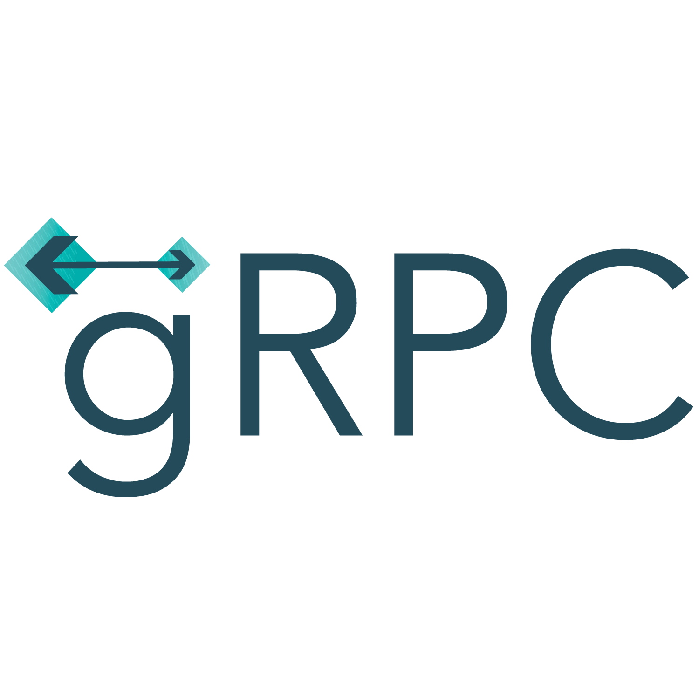
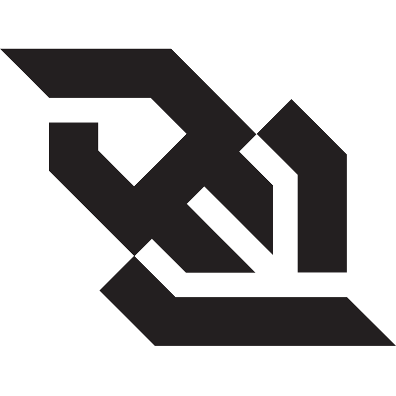

<!-- Top section -->

 

    
    
     
    
    
    
    
      
    
       
    

## 👤 About Me

- 💼 **Senior Software Engineer** with four years of experience in backend development, microservices, and infrastructure automation
- 🧬 Biomedical engineering foundation (HCMUT) — bridging signal processing and digital health with software architecture
- 🛰️ Work spans distributed computing (HTCondor), cloud infrastructure (AWS · FinOps), and enterprise data services
- 🤖 Building enterprise **RAG pipelines** with FastAPI and vector indexing; exploring edge AI inference with ONNX Runtime and Ollama
- 📫 Best reached via email and LinkedIn

---

## 💼 Experience

- **Senior Software Engineer I** @ FPT Software — distributed computing workflows on HTCondor (**GE Vernova**), storage gateway microservices, enterprise RAG pipelines, AWS FinOps
- **Backend Software Engineer** @ CMC Global — event-driven microservices in NestJS / FastAPI (**Oyika Pte Ltd**), high-concurrency gRPC · Kafka · RabbitMQ · WebSockets, API security & OAuth2/JWT hardening
- **Python Software Engineer** @ Terralogic — Python / Ansible IaC modules for Cisco Catalyst Center automation, enterprise Linux & AWS administration

## 🔬 Research & Highlights

- 🧠 **Capstone Thesis (9.17/10):** [Vietnamese Sign Language Recognition](https://github.com/Phat-pham99/Vietnamese_sign_language_recognition_using_MHI_and_CNN) — real-time MHI + CNN classifier for low-latency edge AI inference on Raspberry Pi
- 📄 **IEEE TechRxiv preprint** on Edge AI / IoT architectures
- ⚡ [HTCondor Distributed Workload POC](https://github.com/Phat-pham99/HTCondor_demo) — high-throughput job scheduling with containerized Linux workers on AWS
- 📊 [gRPC Microservices Benchmark](https://github.com/Phat-pham99/gRPC-demo) — gRPC vs. REST performance under high-concurrency IoT telemetry workloads
- 🌐 Open-source contributor — [Cisco Catalyst Center Ansible modules](https://github.com/cisco-en-programmability/dnacenter-ansible)

 

    

 

## 🧰 Tech Stack

### 🐍 Programming Languages

    

### ⚙️ Backend & Distributed Systems

    
     
    
    
    

### ☁️ Cloud & DevOps

    
     
    

### 🧠 Machine Learning & Edge AI

    
     
    
    

### 🤓 Miscellaneous

    
    
    
    

 

    

 

<!-- Bottom section -->
<table align="center" cellspacing="0" cellpadding="0">
    <tr>
        <td align="center" valign="top">
            
        </td>
        <td align="center" valign="top">
            
        </td>
    </tr>
    <tr>
        <td colspan="2" align="center">
            
        </td>
    </tr>
</table>

 

    

